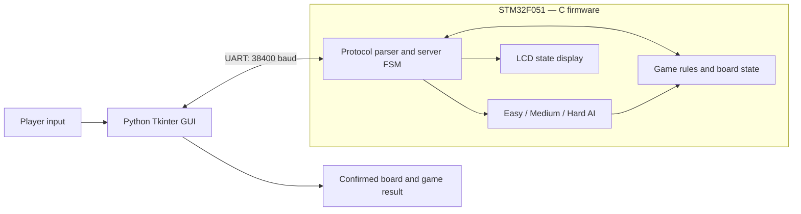

# Serial Game Server — STM32 Tic-Tac-Toe Arena

**An embedded Tic-Tac-Toe game powered by an STM32F051 microcontroller, with a Python desktop interface, three AI difficulty levels, and live server-state feedback on an LCD.**

Developed for **EEE3095S — Embedded Systems II** at the **University of Cape Town (2026)**.

[**Watch the project demonstration**](https://drive.google.com/file/d/1xz4dswl8vDVZFPqHNgssIT_UFEmAekE4/view?usp=drivesdk)

## Overview

This project implements a serial client–server game system in which the **STM32 is the authoritative game server**. The PC application sends player actions over UART, but only the C firmware can validate moves, update the board, select AI moves, or decide when a game ends.

The desktop GUI is a *thin client*: it displays the state confirmed by the board. There is **no separate Python game engine or Python AI opponent**.

### Features

- **Two-player mode:** two people play on the same computer, using the STM32 to enforce the rules.
- **Play against AI:** choose **Easy**, **Medium**, or **Hard** and play as **X** or **O**.
- **Embedded AI:** all AI decision-making runs in C on the STM32.
- **Game validation:** rejects occupied squares, out-of-range indices, invalid commands, and moves after a completed game.
- **UART communication:** newline-terminated ASCII request/response protocol at **38,400 baud**.
- **Onboard LCD:** shows `IDLE`, `IN_PROGRESS`, or `GAME_OVER` as the server changes state.
- **Desktop interface:** dark navy theme, teal/coral player colours, a 3 × 3 board, score tracking, replay, and resignation controls.
- **Physical hardware verification:** **73 automated UART assertions passed, 0 failed** on the STM32-connected system.

## System architecture



The firmware maintains three main states:

| State | Meaning | LCD display |
|---|---|---|
| `IDLE` | No active game; ready to begin | `IDLE` |
| `IN_PROGRESS` | A round is running | `IN_PROGRESS` |
| `GAME_OVER` | Win, draw, or resignation | `GAME_OVER` |

The display writes `SERVER STATE` on its first row and the current state on the second row. It is refreshed when the state changes rather than after every move.

## AI difficulty levels

| Difficulty | Strategy |
|---|---|
| **Easy** | Selects a legal empty square using a pseudo-random choice. |
| **Medium** | Looks for an immediate win, blocks an immediate loss, then prefers useful positions such as the centre or corners. |
| **Hard** | Uses full-depth **minimax with alpha–beta pruning** to evaluate the remaining game tree. |

The AI does not modify the live board during its search. The chosen move is committed through the same C move-validation function used for human players.

## Technology and hardware

| Component | Technology |
|---|---|
| Embedded platform | UCT STM32F051 development board |
| Firmware | C, STM32CubeIDE, STM32 HAL/CMSIS |
| Desktop GUI | Python 3.10+, Tkinter |
| Serial communication | PySerial, UART at 38,400 baud (8-N-1) |
| LCD | UCT character-LCD driver, 4-bit interface |
| Host operating system | Windows (tested with a `COM` serial port) |

The UCT LCD driver uses **PC14** (RS), **PC15** (Enable), **PB8/PB9** (D4/D5), and **PA12/PA15** (D6/D7). The project uses **USART1 on PA9/PA10**, with an onboard button on **PA0** and an LED on **PB0**. The LCD contrast can be adjusted with **POT 2**.

## Repository layout

```text
SerialGameServer/
├── Core/
│   ├── Inc/                 # Firmware headers, including LCD and game declarations
│   └── Src/                 # C game logic, AI, protocol, UART and LCD modules
├── Drivers/                 # STM32 HAL and CMSIS dependencies
├── SerialGameServer.ioc     # STM32CubeMX hardware configuration
├── STM32F051C8TX_FLASH.ld  # MCU linker script
├── gui_client.py            # Tkinter desktop UI
├── serial_client.py         # UART transport and response parsing
├── game_session.py          # UI session and score presentation
├── run_game.bat             # Windows GUI launcher
└── README.md
```

Key firmware modules are `game.c` (rules and AI), `protocol.c` (UART commands and server FSM), `main.c` (MCU initialization and UART processing), `lcd_stm32f0.c` (LCD driver), and `lcd_status.c` (server-state display).

## Getting started

### 1. Requirements

- A **UCT STM32F051 development board** with the project firmware and LCD.
- A USB connection exposing the board's serial interface to the PC.
- **STM32CubeIDE** for building/flashing the firmware.
- **Python 3.10 or newer** on Windows, with Tkinter and PySerial.

### 2. Clone the repository

```powershell
git clone https://github.com/Azile-sidingo/SerialGameServer.git
cd SerialGameServer
```

### 3. Build and flash the STM32 firmware

1. Open **STM32CubeIDE** and import the cloned `SerialGameServer` project.
2. Confirm that the STM32 board is connected and detected through the debugger.
3. **Build** the project, then **Run/Debug** to flash the firmware.
4. Confirm that the LCD displays `SERVER STATE` / `IDLE` after startup.

The STM32CubeIDE project configuration and MCU dependencies are already part of the repository. Do not replace the C firmware with a Python game backend.

### 4. Install the Python dependency

```powershell
py -3 -m pip install pyserial
```

Tkinter is normally included with the standard Windows Python installation.

### 5. Launch the game

```powershell
py -3 gui_client.py
```

Alternatively, double-click **`run_game.bat`**.

1. Select **Two players** or **Play the AI**.
2. For AI mode, choose **Easy**, **Medium**, or **Hard**, and whether you want to play as **X** or **O**.
3. Enter the STM32 serial port (for example, **`COM3`**). Your port may differ.
4. Select **Start Game** and play on the GUI.

**The physical STM32 must be connected and running the firmware:** the Python GUI cannot run a game independently.

## UART message protocol

The PC sends ASCII commands terminated by a newline (`\n`). The STM32 responds with a line of text (terminated by `\r\n`). The nine-character board contains `X`, `O`, or `.` for an empty square.

Board positions are numbered:

```text
 0 | 1 | 2
---+---+---
 3 | 4 | 5
---+---+---
 6 | 7 | 8
```

| Command | Description |
|---|---|
| `CONNECT` | Establish a session while idle. |
| `NEW` | Start or restart a round. |
| `MOVE:<index>` | Play a square numbered 0–8. In AI mode, the STM32 also makes the AI reply before returning the board. |
| `STATE` | Request the authoritative board/server state. |
| `RESIGN` | Forfeit the current round. |
| `DISCONNECT` | Return to idle after a completed round. |
| `MODE:PVP` | Configure two-player mode for the next round. |
| `MODE:AI:<LEVEL>:<MARK>` | Configure the AI's difficulty and symbol for the next round. |

`<LEVEL>` is `EASY`, `MEDIUM`, or `HARD`, and `<MARK>` is the **AI's** symbol (`X` or `O`), not the human's. Mode changes take effect on the next `NEW` command.

Example — human **X** versus Hard AI **O**:

```text
PC  -> STM32: MODE:AI:HARD:O
STM32 -> PC:  OK
PC  -> STM32: NEW
STM32 -> PC:  OK: BOARD:.........
PC  -> STM32: MOVE:0
STM32 -> PC:  OK: BOARD:X...O....
```

Responses include confirmed board states, `WIN:X`, `WIN:O`, or `DRAW` for finished games, and explicit errors such as `NACK: OCCUPIED`, `NACK: RANGE`, `NACK: BADCMD`, and `NACK: NOGAME`. Rejected moves leave the board unchanged.

## Testing and validation

The working STM32 system was checked using an automated Python script communicating with the **physical board** over **COM3 at 38,400 baud** on **26 October 2026**.

**Result: 73 passed, 0 failed.** The assertions covered:

- Session setup and empty-board initialization.
- Legal moves and unchanged state after invalid/occupied/out-of-range requests.
- Malformed commands and unknown requests.
- Winning sequences, full-board draws, and rejection of moves after game over.
- Resignation and clean disconnection.
- Legal AI moves on **Easy, Medium, and Hard**, with AI playing as either **X** or **O**.

Separate host-side C tests exercised game/AI behaviour, including a full-tree check of the Hard AI against reachable human continuations. Physical UART tests verify legal AI moves; they are not, on their own, an exhaustive proof of optimal play.

If you have the companion `real_uart_validation.py` test script, run it with the GUI **closed** (so the COM port is free):

```powershell
py -3 real_uart_validation.py --port COM3 --log real_uart_results.txt
```

> The real-UART test script and test log were produced as submission evidence. Add them to the repository if you want these tests to be reproducible directly from the clone.

## Troubleshooting

| Problem | What to check |
|---|---|
| Cannot open the COM port | Check Windows Device Manager for the correct port, and close any serial monitor or other app using it. |
| No response from STM32 | Confirm power/USB connection, flashed firmware, and **38,400 baud**. |
| `No module named serial` | Run `py -3 -m pip install pyserial`. |
| LCD is blank | Check the LCD connections and adjust contrast using **POT 2**. |
| Game does not start without the board | This is expected: the STM32 is the only game engine. |

## Contributors

- **Sonwabile Qhinga** — AI implementation, game logic, and protocol development.
- **Azile Notoyi** — GUI development, game logic, and protocol development.
- **Both contributors** — testing and documentation.

## Acknowledgements

Developed as part of **EEE3095S Embedded Systems II, University of Cape Town**. The LCD interface uses the UCT STM32F0 teaching driver, originally developed and subsequently ported/modified by the contributors credited in `lcd_stm32f0.c`.

---

**Project demonstration:** [Google Drive video](https://drive.google.com/file/d/1xz4dswl8vDVZFPqHNgssIT_UFEmAekE4/view?usp=drivesdk)
